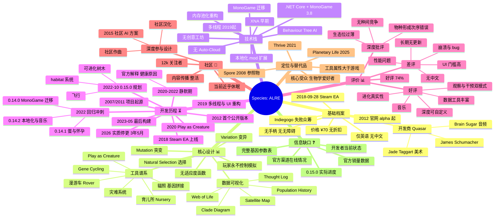

# Species: Artificial Life, Real Evolution — 研究概览

---
研究状态: **已完成（第一轮）**
创建时间: 2026-10-14
最后更新: 2026-10-14
完成度: **85%**
研究方式: 深度研究（deep-research）— 检索 → 分析 → 结构化输出
---

## 研究进度概览

- ✅ 已完成分支：基础档案、技术栈、游戏机制、开发历史、玩家评价、社区生态、市场定位
- ⏳ 待深入分支：完整基因/行为参数表、0.15.0 规划原文精读、社区 fork 动向追踪
- ❓ 信息缺失点：官方销量数据、开发者当前状态与官方渠道在线情况、0.15.0 实际进度

---

## 一句话结论

**Species 是一款在概念上极为硬核、执行上被自身野心拖累的进化模拟器**：它罕见地实现了真正的涌现式自然选择（无适应度函数、无预设目标），并围绕这一主张构建了完整的数据可视化工具链；但物种形成机制的逻辑次序错误与生态位维度过薄，从机制层面限制了多样性涌现，而唯一能解决这些问题的 0.15.0「habitat 系统」规划在 2022 年公开后再无进展。**项目最后一次构建是 2023-05-20，实质已停止开发 3 年 5 个月。**

---

## 关键事实速查表

| 项目 | 内容 | 可信度 |
|------|------|--------|
| 全名 | Species: Artificial Life, Real Evolution | 高 |
| 中文常译 | 《物种：人造生命，真实进化》 | 高 |
| 开发/发行 | Quasar（James Schumacher，独立开发者） | 高 |
| Steam App ID | 774541 | 高 |
| 类型 | Simulation + Early Access | 高 |
| 首发 | 2018-09-28（抢先体验） | 高 |
| 更早版本 | 2012-05-27 起（官网 alpha） | 高 |
| 价格 | ¥70 / $19.99 / €16.79（长期无折扣） | 高 |
| 平台 | Windows / macOS / Linux；Steam Deck Playable | 高 |
| 语言 | **仅英语** | 高 |
| 手柄/无障碍 | **均不支持** | 高 |
| 引擎 | XNA → **MonoGame 3.8 / .NET Core**（0.14.x 起） | 高 |
| 好评率 | **74%**（741 正 / 263 负，共 ~1004 条） | 高 |
| 历史最高同时在线 | **257 人（2019-01-15）** | 高 |
| 当前在线 | 2–6 人 | 高 |
| 关注者 | 12,149 | 高 |
| 销量估算 | ~18k / ~30k / ~52k（**三方模型互相矛盾**） | 低 |
| 收入估算 | 毛 $13K–$102K ｜ 净 $9K–$66K | 低 |
| 平均/中位游戏时长 | 9.7 h / **2.5 h** | 中 |
| **最后构建** | **2023-05-20**（build 11276207） | 高 |
| 众筹 | Indiegogo 目标 $25k，**实得 $1,016 / 43 人** | 高 |
| 当前状态 | **事实弃养（未官方宣布）** | 中高 |

---

## 思维导图

---

## 分支状态表

| 状态标记 | 分支 | 说明 |
|---------|------|------|
| ✅ | 基础档案 | 全部字段已由 Steam 官方 API + 商店页双通道确认 |
| ✅ | 核心设计 | 机制来源为官方一手文案与更新日志 |
| ✅ | 技术栈 | SteamDB 检测结果 + 官方技术声明一致 |
| ✅ | 开发历程 | 时间线由更新日志与 SteamDB 构建记录交叉确认 |
| ✅ | 评价 | 评测数、并发数据为官方/SteamDB 精确值；主题归因为人工判读 |
| ✅ | 社区生态 | 论坛存档与更新日志致谢记录可查 |
| ✅ | 定位与替代品 | 对照作品硬信息可靠；"更好"为主观评价 |
| ⏳ | 0.15.0 设计意图 | 仅获取摘要片段，需精读原文 |
| ⏳ | 社区 fork 动向 | 未检索 |
| ❓ | 官方渠道现状 | **未直接抓取验证，本次研究最大缺口** |
| ❓ | 销量/收入 | 仅有互相矛盾的第三方估算 |
| ❓ | 完整基因参数表 | 无官方文档 |

---

## 文档索引

| 文件 | 内容 |
|------|------|
| [`overview.md`](./overview.md) | 本文件：概览、思维导图、关键事实速查 |
| [`retrieval-report.md`](./retrieval-report.md) | 检索报告：11 个核心发现的完整出处、位置与可信度评级 + 信息缺口 |
| [`analysis/gameplay-design.md`](./analysis/gameplay-design.md) | 游戏设计与模拟机制：核心概念、关系图、6 项深度分析、矛盾与局限 |
| [`analysis/development-status.md`](./analysis/development-status.md) | 开发历程与技术演进：五阶段划分、技术栈演进、当前状态判定、二次开发经验教训 |
| [`analysis/reception-community.md`](./analysis/reception-community.md) | 玩家评价与社区：口碑数据、评价归因、社区生态、市场定位与替代品 |
| [`sources.md`](./sources.md) | 参考来源汇总表（按来源可信度分级） |

---

## 若要继续深入，建议的下一步

1. **补验证官方渠道现状** — 直接抓取 speciesgame.com 与 speciesdevblog.wordpress.com，确认项目是否"死亡但未宣布"。这是当前唯一能改变结论强度的事项
2. **精读 0.15.0 规划原文** — 2022-10-24 那篇开发日志是理解 habitat 系统设计推理的关键文本，也是评估"该思路是否可被他人接手实现"的必要材料
3. **系统抓取全部 1004 条 Steam 评测** — 用 appreviews API 做主题聚类，把本报告中人工判读的评价主题升级为统计结论
4. **整理官方论坛存档中的社区设计提案** — 2015 年那份 AI 方案证明社区曾深入参与设计，系统挖掘可还原"玩家理想中的模拟器"，对二次开发价值高